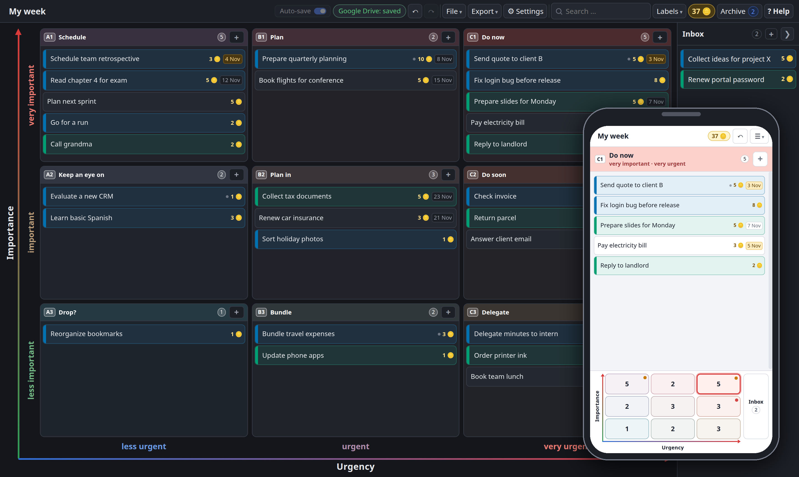

# Eisenhower Matrix+

**A free Eisenhower matrix in your browser, in the size that suits you: 2×2, 3×3, 5×5 or anything in between.**
No installation, no account, no data upload.

👉 **Open the tool: https://master-d1990.github.io/eisenhower-matrix/**

[English](#english) · [Deutsch](#deutsch) · [For developers](#for-developers)



---

## English

### What is an Eisenhower matrix?

The Eisenhower matrix sorts tasks by two questions: **how important** is it, and **how urgent**? The classic version has four fields: do it now, plan it, delegate it, drop it. Many tasks are "a bit important" or "fairly urgent", so this tool lets you choose **three levels per axis (recommended)** or anything from one to five.

### What can the tool do?

- **Adjustable size:** 2×2 classic, 3×3 recommended, 4×4 and 5×5, or your own, e.g. 4×1 for importance only. When you change the size, every task keeps its position and comes back to its old field when you change back.
- **Axes like a chart:** importance upwards (green to red), urgency to the right (blue to red). Swap the axes or reverse a direction, e.g. "urgent" on the left as in the classic scheme. Field names and levels can be renamed by double-click.
- **Tasks:** add them with **+** in the field, move them by drag & drop, open them for a description, due date, labels and more. Overdue and soon-due dates are highlighted.
- **Inbox:** jot something down without sorting it yet, sort it in later. Can be switched off.
- **Archive:** done tasks go to the archive, from where you can restore them.
- **Labels** such as "Work" and "Private" with your own colours, and a filter to show or hide them. With **↑** in the labels menu, the tasks of one label come to the top of every cell, e.g. "Work" while you are at work. With coins on, you can also sort by coins. Both only change the view, your own order stays.
- **Gold coins (optional):** give tasks a coin value, collect coins when you finish them and spend them on your own rewards. Rule of thumb: 1 coin ≈ 15 minutes of work. New tasks start with **?**: you name the value when the task is done, or set it in the task right away.
- **Sounds (optional, per device):** short sounds when you add, move, finish, delete or undo, a chime for every coin.
- **Phone:** the list of the chosen field at the top, the matrix as buttons at the bottom; long-press a card and drop it on a button to move it, swipe right to finish it.
- **Export** to CSV or PDF (print), **dark mode**, colour strength, **English and Swiss German**, built-in help.

### Where is my data stored?

**Only on your own computer.** The tool does not upload anything.

- Your matrix is cached in your browser automatically. That cache is **not a backup**: it is lost if you clear your browser data or use another browser.
- **Chrome and Edge:** choose a file once (e.g. in a cloud folder like OneDrive, Google Drive, Dropbox or Syncthing). With **Auto-save** on, every change is written to that file right away.
- **Firefox and Safari:** click **Save** regularly. This downloads a `.matrix.json` file.
- **Google Drive (optional, every browser):** **File → Connect Google Drive** saves your matrix in your own Google Drive and keeps it in sync across devices. Changes made on two devices, even offline, are merged task by task. The tool only gets access to the file it creates (`drive.file`).
- To use the matrix on several devices, keep the file in a synced folder and open it there. Only one device should edit it at a time.

### Privacy, security and warranty

- **Privacy:** the tool sends no data, except to your own Google Drive if you connect it ([privacy policy](https://master-d1990.github.io/eisenhower-matrix/privacy.html)). The website is hosted on GitHub Pages, and GitHub may log technical data such as your IP address ([GitHub privacy statement](https://docs.github.com/en/site-policy/privacy-policies/github-general-privacy-statement)).
- **Security:** `.matrix.json` files contain only data, no code. The tool checks every file when opening it.
- **Warranty:** use at your own risk, without any warranty. See the [MIT License](LICENSE).

### Use it offline

Click **? Help → Download the tool (use offline)**, or download [`index.html`](index.html). Double-click the file and the tool works without internet. It contains only the tool, not your data.

**Install as an app:** in Chrome or Edge click the install icon in the address bar (or menu → *Install*). The tool then opens in its own window, has its own icon and also starts without internet. On Android: menu → *Add to home screen*.

### Questions, bugs, ideas

Open an [issue on GitHub](https://github.com/Master-D1990/eisenhower-matrix/issues).

---

## Deutsch

### Was ist eine Eisenhower-Matrix?

Die Eisenhower-Matrix ordnet Aufgaben nach zwei Fragen: **Wie wichtig** ist sie, und **wie dringend**? Die klassische Form hat vier Felder: sofort erledigen, planen, delegieren, streichen. Viele Aufgaben sind aber „ein bisschen wichtig“ oder „ziemlich dringend“. Darum kannst du hier **drei Stufen pro Achse (empfohlen)** wählen oder alles von einer bis fünf.

### Was kann das Tool?

- **Einstellbare Grösse:** 2×2 klassisch, 3×3 empfohlen, 4×4 und 5×5 oder eigene Formate, etwa 4×1 nur für die Wichtigkeit. Beim Umstellen merkt sich jede Aufgabe ihre Lage und kommt beim Zurückstellen wieder ins alte Feld.
- **Achsen wie im Diagramm:** Wichtigkeit nach oben (grün nach rot), Dringlichkeit nach rechts (blau nach rot). Du kannst die Achsen tauschen oder eine Richtung umkehren, etwa „dringend“ links wie im klassischen Schema. Feldnamen und Stufen änderst du per Doppelklick.
- **Aufgaben:** mit **+** direkt im Feld anlegen, per Drag & Drop verschieben, öffnen für Beschreibung, Frist, Labels und mehr. Überfällige und bald fällige Fristen sind markiert.
- **Ablage:** schnell etwas notieren, ohne es gleich einzuordnen, und später einsortieren. Lässt sich ausschalten.
- **Archiv:** Erledigtes wandert ins Archiv und lässt sich von dort wiederherstellen.
- **Labels** wie „Beruf“ und „Privat“ mit eigenen Farben, dazu ein Filter zum Ein- und Ausblenden. Mit **↑** im Label-Menü kommen die Tasks eines Labels in jedem Feld nach oben, zum Beispiel „Beruf“ während der Arbeit. Mit Münzen lässt sich auch nach Münzen sortieren. Beides ändert nur die Ansicht, die eigene Reihenfolge bleibt.
- **Goldmünzen (freiwillig):** Gib Aufgaben einen Münzwert, sammle die Münzen beim Erledigen und gönn dir damit deine eigenen Belohnungen. Faustregel: 1 Münze ≈ 15 Minuten Arbeit. Neue Aufgaben starten mit **?**: Den Wert nennst du beim Erledigen oder gleich in der Aufgabe.
- **Töne (freiwillig, pro Gerät):** kurze Töne beim Erstellen, Verschieben, Erledigen, Löschen und Rückgängig, ein Klingeln für jede Münze.
- **Handy:** oben die Liste des gewählten Felds, unten die Matrix als Knöpfe. Karte lange drücken und auf einen Knopf ziehen zum Verschieben, nach rechts wischen zum Erledigen.
- **Export** als CSV oder PDF (Drucken), **Dark Mode**, Farbstärke, **Schweizerdeutsch und Englisch**, eingebaute Hilfe.

### Wo werden meine Daten gespeichert?

**Nur auf deinem eigenen Computer.** Das Tool lädt nichts hoch.

- Deine Matrix wird automatisch im Browser zwischengespeichert. Dieser Zwischenspeicher ist **keine Sicherung**: Er geht verloren, wenn du die Browserdaten löschst oder einen anderen Browser nutzt.
- **Chrome und Edge:** Wähle einmal eine Datei, zum Beispiel in einem Cloud-Ordner wie OneDrive, Google Drive, Dropbox oder Syncthing. Mit **Automatisch speichern** landet danach jede Änderung sofort in dieser Datei.
- **Firefox und Safari:** Klicke regelmässig auf **Speichern**. Das lädt eine `.matrix.json`-Datei herunter.
- **Google Drive (freiwillig, jeder Browser):** Mit **Datei → Mit Google Drive verbinden** liegt deine Matrix in deinem eigenen Google Drive und bleibt auf allen Geräten aktuell. Änderungen auf zwei Geräten, auch offline, werden Aufgabe für Aufgabe zusammengeführt. Das Tool erhält nur Zugriff auf die Datei, die es selbst anlegt (`drive.file`).
- Für mehrere Geräte legst du die Datei in einen synchronisierten Ordner und öffnest sie dort. Es sollte immer nur ein Gerät gleichzeitig daran arbeiten.

### Datenschutz, Sicherheit und Gewähr

- **Datenschutz:** Das Tool sendet keine Daten, ausser an dein eigenes Google Drive, wenn du es verbindest ([Datenschutzerklärung](https://master-d1990.github.io/eisenhower-matrix/privacy.html)). Die Seite liegt auf GitHub Pages, GitHub kann technische Daten wie die IP-Adresse protokollieren ([Datenschutzerklärung von GitHub](https://docs.github.com/de/site-policy/privacy-policies/github-general-privacy-statement)).
- **Sicherheit:** `.matrix.json`-Dateien enthalten nur Daten, keinen Code. Das Tool prüft jede Datei beim Öffnen.
- **Gewähr:** Nutzung auf eigenes Risiko, ohne Gewähr. Siehe [MIT-Lizenz](LICENSE).

### Offline nutzen

Klicke auf **? Hilfe → Tool herunterladen (offline nutzen)** oder lade [`index.html`](index.html) herunter. Ein Doppelklick auf die Datei genügt, und das Tool läuft ohne Internet. Die Datei enthält nur das Tool, nicht deine Daten.

**Als App installieren:** In Chrome oder Edge auf das Installieren-Symbol in der Adressleiste klicken (oder Menü → *Installieren*). Das Tool öffnet sich dann in einem eigenen Fenster, hat ein eigenes Symbol und startet auch ohne Internet. Auf Android: Menü → *Zum Startbildschirm hinzufügen*.

### Fragen, Fehler, Ideen

Eröffne ein [Issue auf GitHub](https://github.com/Master-D1990/eisenhower-matrix/issues).

---

## For developers

The whole tool is a single file, [`index.html`](index.html): HTML, CSS and plain JavaScript, **no dependencies and no build step**. What is in the repository is exactly what runs, so the tool also works offline with a double-click. GitHub Pages serves the `main` branch directly.

### Google Drive helper

Google gives a browser-only app a one-hour sign-in only. [`worker/token-worker.js`](worker/token-worker.js) is a tiny Cloudflare Worker that adds the OAuth client secret and forwards two requests to Google's token endpoint, so the connection lasts. It stores nothing and never sees the matrix. Its settings are `GOOGLE_CLIENT_ID` (text) and `GOOGLE_CLIENT_SECRET` (secret); the page points to it with `GDRIVE_TOKEN_URL`.

### Tests

`node tests/run.mjs` runs the browser tests (Node 22+ and Chrome or Chromium, no `npm install`): loading, axes in every direction on desktop and phone, view settings, merging changes of two devices and the Google Drive sync against an emulated Drive. They also run on every push via GitHub Actions.

### File format (`.matrix.json`)

```json
{
  "format": "eisenhower-matrix",
  "version": 1,
  "title": "My matrix",
  "rows": 3, "cols": 3,
  "swapped": false, "flipX": false, "flipY": false,
  "axisY": "Importance", "axisX": "Urgency",
  "rowLabels": ["very important", "important", "less important"],
  "colLabels": ["less urgent", "urgent", "very urgent"],
  "cellNames": [["Schedule", "Plan", "Now"], ["…"], ["…"]],
  "labels": [{ "id": "l_1", "name": "Work", "color": "#1f77b4" }],
  "tasks": [{ "id": "t_1", "title": "…", "desc": "…", "due": "2026-11-05",
              "cell": [0, 2], "at": [0.83, 0.83], "labels": ["l_1"], "coins": 10,
              "created": "2026-11-02T10:00:00.000Z" }],
  "archive": [{ "…": "same as a task", "doneAt": "…", "fromCell": [0, 2] }],
  "coins": { "enabled": false, "balance": 0, "rewards": [], "log": [] }
}
```

- `rows` are the levels of the vertical axis (index 0 = top = highest), `cols` the levels of the horizontal axis (index 0 = left = lowest). `swapped`, `flipX` and `flipY` only change how the matrix is shown.
- `cell` is `null` for tasks in the inbox. `at` is the task's position on both axes (0 to 1); it decides the field again whenever the size changes.
- Personal view settings (theme, language, colour strength, filters, hidden axes) are kept in the browser only, not in the file.

## License

[MIT](LICENSE) © 2026 Master-D1990
